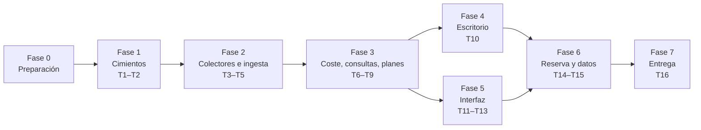

# Fases de construcción

La app se construye en **8 fases** (0 a 7). Cada fase agrupa tareas del [plan](superpowers/plans/2026-11-26-gestor-tokens.md), las asigna a un agente y a un modelo, y termina en una **puerta**: una lista de comprobaciones que debe cumplirse antes de pasar a la siguiente.

Las fases 4 y 5 pueden ir en paralelo: la interfaz usa datos simulados hasta que existen los comandos reales.

## Resumen

| Fase | Tareas | Agente | Nivel | Revisión en la puerta | Riesgo | Cuota de Gemini |
| --- | --- | --- | --- | --- | --- | --- |
| 0 Preparación | — | Usuario + Orchestrator | — | Usuario + Claude | Bajo | Muy baja |
| 1 Cimientos | T1, T2 | `implementador-nucleo` | `pro` | `verificador` + `revisor` | Medio: toolchain de Windows | Media |
| 2 Colectores e ingesta | T3 ∥ T4 → T5 | `implementador-nucleo` | `pro` | `verificador` + `revisor` | **Alto: contar mal** | Alta |
| 3 Coste, consultas, planes | T6 → T7 ∥ T8 → T9 | `implementador-nucleo` | `pro` | `verificador` + **Carbon** + **Claude** | **Máximo: dinero** | Alta |
| 4 Escritorio | T10 | `implementador-nucleo` | `pro` | `verificador` + `revisor` + usuario | Alto: hilos, bandeja | Media |
| 5 Interfaz | T11 → T12 ∥ T13 | `implementador-ui` | `flash` | `verificador` + `qa-app` | Medio | Alta (reserva permitida) |
| 6 Reserva y datos | T14 → T15 | `implementador-nucleo` | `pro` | `verificador` + `revisor` | Medio: secretos | Media |
| 7 Entrega | T16 | `implementador-nucleo` + usuario | `pro` | **Carbon** + usuario | Medio | Baja |

Los agentes, los modelos, el peso y el razonamiento de cada tarea están en [02-agentes-y-modelos.md](02-agentes-y-modelos.md).

---

## Fase 0: Preparación (sin código de la app)

**Objetivo:** dejar listo el entorno de Rust en Windows, Antigravity configurado y comprobadas las suposiciones que la documentación no puede comprobar sola.

**Quién:** el usuario, con ayuda del Orchestrator para las comprobaciones.

**Instalar (usuario, en PowerShell):**

- [ ] **Rust:** `winget install Rustlang.Rustup` y después `rustup default stable-x86_64-pc-windows-msvc`. Comprobar `rustc --version` (≥ 1.85) y `cargo --version`.
- [ ] **MSVC Build Tools:** `winget install Microsoft.VisualStudio.2022.BuildTools` y, en el instalador, marcar «Desarrollo para el escritorio con C++» (MSVC y Windows SDK). Sin esto `cargo build` falla al enlazar.
- [ ] **WebView2:** viene con Windows 11; comprobar que existe `C:\Program Files (x86)\Microsoft\EdgeWebView\Application`.
- [ ] **Git:** `git init` en `E:\Proyectos\Gestior de Tokens\Alpha` y primer commit con la documentación (`git add docs AGENTS.md .agents handoff HXqFtqPXgAAf9KE.jpg` → `git commit -m "docs: documentación inicial"`).
- [ ] **Ollama:** abrir Ollama y `ollama pull qwen3:4b`, `ollama pull qwen3.5:2b`, `ollama pull gemma4:e4b` (si alguna etiqueta no existe, anotar la lista que muestra `ollama search` o la web de Ollama).
- [ ] **opencode:** instalarlo (`npm i -g opencode-ai`), configurar los proveedores **DeepSeek** (con la clave de la API) y **Ollama**, y hacer una consulta corta con cada uno para que queden sesiones en disco.
- [ ] **SQLite (línea de comandos):** `winget install SQLite.SQLite` y comprobar `sqlite3 --version`. Solo sirve para inspeccionar la base de opencode en la parte «Comprobar»; la app no lo usa.

**Comprobar (prompt para Antigravity, en modo Orchestrator):**

> Ejecuta la fase 0 de `docs/01-fases.md`, parte «Comprobar». No escribas código. Escribe los resultados en `handoff/fase-0-informe.md`.

- [ ] Cargados: `AGENTS.md`, las reglas de `.agents/rules/`, las skills de `.agents/skills/` y los 5 subagentes de `.agents/agents/`. Para cada subagente, su modelo real y sus herramientas (invocarlo y pedirle que las liste sin escribir nada).
- [ ] **Antigravity cuenta la caché dentro de la entrada:** en 3 conversaciones distintas de `%USERPROFILE%\.gemini\antigravity\brain\`, comprobar en `transcript.jsonl` que `input_tokens ≥ cache_read_tokens` en todos los pasos con `source = MODEL`. Anotar cuántos pasos se revisaron y si alguno no cumple. **Solo números: no copiar ningún texto del transcript.**
- [ ] **Claude Code:** en 2 archivos de `%USERPROFILE%\.claude\projects\`, contar cuántas líneas `assistant` comparten `message.id` (confirma la deduplicación de `docs/06` §1.1).
- [ ] **opencode:** se espera una base SQLite en `%USERPROFILE%\.local\share\opencode\opencode.db` (investigación del 26/11/2026 sobre el código de opencode 1.19.6). Hacer estas comprobaciones **en este orden** y anotar la salida. **Solo nombres de tablas, ids, números y fechas: nunca texto de mensajes ni de partes, y nunca la tabla de credenciales.**
  1. `opencode --version` y `opencode db path`. Si la ruta no es la esperada, usar la que imprime en los pasos siguientes.
  2. **Antes de abrir la base:** con opencode cerrado, anotar qué archivos hay junto a ella (`Get-ChildItem "$env:USERPROFILE\.local\share\opencode" -Filter "opencode*"`). Interesa si existen `opencode.db-wal` y `opencode.db-shm`.
  3. Tablas: `sqlite3 -readonly "<ruta>" ".tables"`.
  4. **Si existe la tabla `message` (esquema v1):**
     - `sqlite3 -readonly "<ruta>" ".schema message"` y `".schema session"`.
     - Uso de los 4 últimos mensajes del asistente (al menos uno de DeepSeek y uno de Ollama):
       `sqlite3 -readonly "<ruta>" "SELECT id, time_created, json_extract(data,'$.providerID'), json_extract(data,'$.modelID'), json_extract(data,'$.tokens'), json_extract(data,'$.cost'), json_extract(data,'$.time.created'), json_extract(data,'$.time.completed'), json_extract(data,'$.summary') FROM message WHERE json_extract(data,'$.role')='assistant' ORDER BY time_created DESC LIMIT 4;"`
     - ¿Las partes `step-finish` repiten los tokens del mensaje? Para los mismos mensajes:
       `sqlite3 -readonly "<ruta>" "SELECT message_id, json_extract(data,'$.tokens'), json_extract(data,'$.cost') FROM part WHERE json_extract(data,'$.type')='step-finish' ORDER BY time_created DESC LIMIT 8;"`
       Anotar si la suma de las `step-finish` de un mensaje coincide con los `tokens` de ese mensaje.
  5. **Si en su lugar existen `session_v2` y `session_message` (esquema v2):** `".schema session_message"` y
     `sqlite3 -readonly "<ruta>" "SELECT id, type, time_created, json_extract(data,'$.model'), json_extract(data,'$.tokens'), json_extract(data,'$.cost'), json_extract(data,'$.time.completed') FROM session_message WHERE type IN ('assistant','compaction') ORDER BY time_created DESC LIMIT 4;"`
  6. **Después de las consultas:** repetir el listado del paso 2 y anotar si `sqlite3 -readonly` creó o modificó algún archivo (`-shm`, `-wal`) y su fecha. Decide cómo abrirá la base la app sin escribir en la carpeta de opencode.
  7. Configuración: ruta de `opencode.json` y si opencode cargó `AGENTS.md` y las skills de `.agents/skills/` (pedirle en opencode que liste sus skills sin ejecutar nada).
- [ ] **DeepSeek:** id exacto del modelo con `GET https://api.deepseek.com/models` (con la clave del usuario; no escribir la clave en el informe). Ojo: en models.dev `deepseek-v4-flash` aparece como obsoleto y el nombre actual es `deepseek-flash`; anotar los ids que devuelva la API y el `modelID` que guarda opencode (paso 4 o 5 de arriba).
- [ ] **Modelo local:** la calibración de `02-agentes-y-modelos.md` §4 con los 3 candidatos; tabla de aciertos y segundos.
- [ ] **Versiones:** `rustc`, `cargo`, `node`, `npm`, `git`, `ollama`, `opencode`.
- [ ] **Cuota de Google AI Pro en dólares** (la pone el usuario en el informe).

**Puerta 0:** `handoff/fase-0-informe.md` existe con todo lo anterior. El usuario se lo pasa a Claude: «Lee `handoff/fase-0-informe.md` y actualiza la documentación». Claude completa `docs/06-colectores-y-costes.md` §1.3 y §3.2, responde en `docs/respuestas.md` y anota los cambios en `docs/CHANGELOG.md`.

---

## Fase 1: Cimientos (T1, T2)

**Objetivo:** el proyecto Tauri compila y abre una ventana; el esquema SQLite se aplica.

**Prompt para Antigravity:**

> Ejecuta la fase 1 de `docs/01-fases.md`. Para T1 y después T2, invoca el subagente `implementador-nucleo` con la skill `ejecutar-tarea-tdd` y el número de tarea. Espera a que termine cada una. Al acabar, usa la skill `cerrar-fase` con fase 1.

**Puerta 1:**

- [ ] `cargo test` y `npm test` en verde.
- [ ] `cargo clippy -- -D warnings` sin avisos.
- [ ] `cargo tree -p gestor_core -e normal` no contiene `tauri` (ver `03-arquitectura.md` §1).
- [ ] `npm run tauri dev` abre la ventana «Gestor de Tokens» (el usuario lo confirma).
- [ ] 2 commits con los mensajes del plan; informe en `handoff/fase-1-informe.md`.

---

## Fase 2: Colectores e ingesta (T3 ∥ T4 → T5)

**Objetivo:** leer los logs de Claude Code y Antigravity sin perder ni duplicar nada.

**Prompt para Antigravity:**

> Ejecuta la fase 2 de `docs/01-fases.md`. Lanza en paralelo dos subagentes `implementador-nucleo`, cada uno en un workspace `branch`: uno para T3 y otro para T4, con la skill `ejecutar-tarea-tdd`. Fusiona T3 y luego T4, ejecuta `cargo test` y después invoca `implementador-nucleo` para T5. Al acabar, usa la skill `cerrar-fase` con fase 2.

**Puerta 2:**

- [ ] `cargo test` en verde, con las pruebas de los «Puntos de atención» 1, 2 y 5 del plan.
- [ ] El `revisor` confirma que ningún struct de los colectores declara campos de contenido (`content`, `thinking`, `text`, `display`).
- [ ] **Prueba con datos reales (usuario):** un binario de prueba `cargo run --example contar` (lo crea T5) imprime los totales por herramienta y modelo de los logs reales del usuario. Comparar los totales de Claude Code de los últimos 7 días con `npx ccusage@latest daily` (deben coincidir en ±1 %). Anotar ambos en el informe.

---

## Fase 3: Coste, consultas y planes (T6 → T7 ∥ T8 → T9)

**Objetivo:** cada evento con su coste; los datos de las pantallas; ventanas de 5 h y semanales; alertas.

**Antes de empezar:** Claude ha completado `docs/06-colectores-y-costes.md` §3.2 (precios de Gemini 4).

**Prompt para Antigravity:**

> Ejecuta la fase 3 de `docs/01-fases.md`. Invoca `implementador-nucleo` para T6. Después lanza en paralelo, en workspaces `branch`, T7 y T8. Fusiona T7 y T8, ejecuta `cargo test` e invoca `implementador-nucleo` para T9. Al acabar, usa la skill `cerrar-fase` con fase 3.

**Revisión reforzada con Carbon:** el usuario cambia el modelo de la conversación a **Gemini 4 Carbon** con razonamiento **High** y pide:

> Revisa `app/src-tauri/src/core/cost.rs`, `pricing.rs`, `plans.rs`, `query.rs` y `alerts.rs` contra `docs/06-colectores-y-costes.md`, `docs/04-comandos.md` y las «Restricciones globales» del plan. Busca: costes que cuenten como 0 lo que no tiene precio, razonamiento cobrado dos veces, recálculos que toquen eventos de otro modelo o fuera del rango, ventanas que cuenten eventos de fuera, fechas en UTC donde debería ser hora local, divisiones por cero en porcentajes y rendimiento. Escribe los hallazgos en `handoff/fase-3-revision-carbon.md` sin cambiar código.

**Revisión de Claude:** el usuario pide en Claude Code: «Revisa la fase 3: `git diff` de la fase en `app/src-tauri/src/core/` contra la spec §8.5 y §8.6». Claude escribe en `handoff/fase-3-revision-claude.md`.

Los hallazgos graves de las dos revisiones los corrige `implementador-nucleo` antes de la puerta.

**Puerta 3:**

- [ ] `cargo test` en verde.
- [ ] Sin hallazgos graves abiertos de Carbon ni de Claude.
- [ ] `cargo run --example contar` muestra ahora el coste equivalente de los últimos 30 días por modelo; el usuario lo ve razonable frente a su uso.

---

## Fase 4: Escritorio (T10)

**Objetivo:** comandos, vigilancia de logs en vivo, bandeja y notificaciones.

**Prompt para Antigravity:**

> Ejecuta la fase 4 de `docs/01-fases.md`. Invoca `implementador-nucleo` con la skill `ejecutar-tarea-tdd` para T10. Al acabar, usa la skill `cerrar-fase` con fase 4.

**Puerta 4:**

- [ ] `cargo test` en verde, con las pruebas de `tests/commands.rs`.
- [ ] **Usuario:** con `npm run tauri dev`, enviar un mensaje en Claude Code → en < 5 s la bandeja y `get_today_summary` cambian. Cerrar la ventana → la app sigue en la bandeja. Una segunda instancia enfoca la primera.
- [ ] **Usuario:** con un límite calibrado bajo a propósito, llega la notificación de Windows del 80 %.

---

## Fase 5: Interfaz (T11 → T12 ∥ T13)

**Objetivo:** las 6 pantallas, fieles a los mockups.

**Prompt para Antigravity:**

> Ejecuta la fase 5 de `docs/01-fases.md`. Invoca `implementador-ui` con las skills `ejecutar-tarea-tdd` y `mockup-a-react` para T11. Después lanza en paralelo, en workspaces `branch`, T12 y T13. Fusiona, ejecuta `npm test` e invoca `qa-app` para comparar cada pantalla con su mockup según `docs/05-ui.md`. Al acabar, usa la skill `cerrar-fase` con fase 5.

**Si se acaba la cuota de Gemini:** el usuario puede seguir T12 o T13 con DeepSeek en opencode (`02-agentes-y-modelos.md` §5).

**Puerta 5:**

- [ ] `npm test` y `npx tsc --noEmit` en verde.
- [ ] `qa-app` adjunta una captura de cada pantalla con datos simulados y la lista de diferencias con el mockup. Solo se aceptan diferencias de datos.
- [ ] Teclado: `Ctrl+1…6`, `R`, `7/3/9/T`, `Esc`; foco visible.
- [ ] **Usuario:** `npm run tauri dev` con datos reales: las 6 pantallas cargan sin errores.

---

## Fase 6: Reserva y datos (T14 → T15)

**Antes de empezar:** `docs/06-colectores-y-costes.md` §1.3 completo (lo hace Claude tras la fase 0).

**Prompt para Antigravity:**

> Ejecuta la fase 6 de `docs/01-fases.md`. Invoca `implementador-nucleo` con la skill `ejecutar-tarea-tdd` para T14 y después para T15. Al acabar, usa la skill `cerrar-fase` con fase 6.

**Puerta 6:**

- [ ] `cargo test` en verde; `cargo test -- --ignored keyring_ida_y_vuelta` en verde (lo ejecuta el usuario).
- [ ] **Usuario:** guardar la clave de DeepSeek en Ajustes → aparece en el Administrador de credenciales de Windows como `GestorTokens`; Planes muestra el saldo; ningún archivo de `%APPDATA%\GestorTokens\` contiene la clave (buscar los 6 últimos caracteres con `Select-String`).
- [ ] Exportar a CSV y abrirlo en Excel: columnas de `06` §6, acentos bien.

---

## Fase 7: Entrega (T16)

**Pasos:**

1. `implementador-nucleo`: T16, pasos 1–4 y 6.
2. **Usuario:** `npm run tauri build`, instalar el `.exe` de NSIS, recorrer CU1–CU11 del plan y anotar el resultado en `handoff/fase-7-cu.md`.
3. **Revisión final con Carbon (High):** como en la fase 3, sobre todo `app/`, con salida en `handoff/fase-7-revision-carbon.md`. Foco: privacidad (contenido de logs o claves que se filtren), capabilities de Tauri, CSP y errores que lleguen sin traducir.

**Puerta 7 (entrega):**

- [ ] Todas las baterías en verde, incluido `panel_rapido` (< 300 ms).
- [ ] Reposo medido: < 1 % de CPU y < 150 MB, anotado en el README.
- [ ] CU1–CU11 correctos.
- [ ] Sin hallazgos graves de Carbon.
- [ ] El usuario da el visto bueno.
