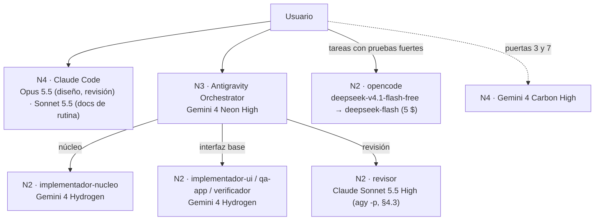

# Agentes y modelos: quién hace cada tarea, con qué modelo y con qué intensidad

Revisado el 26/11/2026 con datos medidos en el equipo del usuario y fuentes citadas en §8 y §9.

Tres herramientas y un presupuesto:

- **Claude Code (Claude Pro)** gestiona: diseña, documenta, responde a `handoff/` y revisa lo delicado. Es la cuota más escasa, así que **no programa** (§6).
- **Antigravity (Google AI Pro)** programa el núcleo y lo que tiene errores silenciosos. Orchestrator con Gemini 4 Neon planifica y Gemini 4 Hydrogen ejecuta.
- **opencode** programa en paralelo las tareas que las pruebas verifican bien, **primero con modelos gratuitos** y, cuando se agotan, con **DeepSeek de pago, con un tope de 5 $** (§5).
- **Gemini 4 Carbon (High)** solo en las revisiones de las puertas 3 y 7.

## 1. La jerarquía



Un subagente de Antigravity no puede usar Claude (§4.1), pero una sesión de `agy` lanzada por Claude desde la consola sí (§4.3). Así el `revisor` corre con Claude Sonnet 5.5 High y Claude revisa además las fases 3 y 7.

| Nivel | Herramienta y modelo | Cuota que gasta | Hace | No hace nunca |
| --- | --- | --- | --- | --- |
| **N4 Gestor** | Claude Code: Opus 5.5 · Sonnet 5.5 | Claude Pro (5 h y semanal) | Spec, plan, contratos, respuestas a `handoff/`, revisión de la fase 3 | Escribir código de `app/` |
| **N4 Revisión de puerta** | Antigravity: Gemini 4 Carbon High | Google AI Pro (Gemini) | Puertas 3 y 7 | Corregir código |
| **N3 Planificador** | Antigravity: Orchestrator (Neon High) | Google AI Pro (Gemini) | Repartir tareas, fusionar ramas, informes | Implementar |
| **N2 Implementador** | Antigravity: Gemini 4 Hydrogen · opencode: DeepSeek V4.1 Flash | Google AI Pro · gratis · 5 $ | Código con TDD, verificación, QA | Cambiar `docs/` |

## 2. Carga, modelo e intensidad de cada tarea

**Carga** = tamaño (S < 200 líneas, M 200–600, L > 600). **Error** = cuánto cuesta detectarlo: *silencioso* si pasa unas pruebas débiles y se paga después (contar mal, cobrar mal, límites, secretos, hilos); *visible* si las pruebas o una captura lo detectan enseguida.

**Intensidad** = nivel de razonamiento del modelo. En Antigravity son variantes del modelo (`gemini-4-hydrogen-low|medium|high|xhigh`, lista de `agy models`). En opencode son variantes de DeepSeek V4.1 Flash (`low|high|max`): el agente arranca en `low` y `opencode run --variant high` sube la intensidad.

| Tarea | Carga | Error | Herramienta y agente | Modelo | Intensidad inicial | Si falla dos veces (verificado) | Revisión |
| --- | --- | --- | --- | --- | --- | --- | --- |
| T1 Proyecto Tauri | M | Visible | Antigravity `implementador-nucleo` | Hydrogen | High | XHigh | verificador |
| T2 Modelo y BD | M | Silencioso | Antigravity `implementador-nucleo` | Hydrogen | High | XHigh → `handoff/` | revisor |
| T3 Colector Claude Code | M | Silencioso | Antigravity `implementador-nucleo` | Hydrogen | High | XHigh → `handoff/` | revisor |
| T4 Colector Antigravity | S | Visible | Antigravity `implementador-nucleo` | Hydrogen | High | XHigh | revisor |
| T5 Ingestión | L | Silencioso | Antigravity `implementador-nucleo` | Hydrogen | High | XHigh → `handoff/` | revisor |
| T6 Precios y coste | M | **Silencioso, dinero** | Antigravity `implementador-nucleo` | Hydrogen | High | XHigh → `handoff/` | revisor + Carbon + Claude |
| T7 Consultas | L | Silencioso | Antigravity `implementador-nucleo` | Hydrogen | High | XHigh → `handoff/` | revisor + Carbon |
| T8 Planes y ventanas | M | **Silencioso, límites** | Antigravity `implementador-nucleo` | Hydrogen | High | XHigh → `handoff/` | revisor + Carbon + Claude |
| T9 Alertas | S | Visible | Antigravity `implementador-nucleo` | Hydrogen | High | XHigh | revisor |
| T10 Capa de escritorio | L | Silencioso (hilos) | Antigravity `implementador-nucleo` | Hydrogen | High | XHigh → `handoff/` | revisor |
| T11 Interfaz base y Panel | L | Visible | Antigravity `implementador-ui` | Hydrogen | High | XHigh | qa-app |
| T12 Costes y Sesiones | M | Visible | Antigravity `implementador-ui` | Hydrogen | High | XHigh | qa-app |
| T13 Planes, Fuentes, Ajustes | M | Visible | **opencode** `implementador` (en paralelo con T12) | DeepSeek V4.1 Flash | `low` | `high`; si vuelve a fallar, Antigravity `implementador-ui` | qa-app |
| T14 opencode y DeepSeek | M | Silencioso (secretos) | Antigravity `implementador-nucleo` | Hydrogen | High | XHigh → `handoff/` | revisor |
| T15 Exportar e importar | S | Visible | **opencode** `implementador` | DeepSeek V4.1 Flash | `low` | `high`; si vuelve a fallar, Antigravity `implementador-nucleo` | revisor |
| T16 Entrega | M | Visible | Antigravity `implementador-nucleo` + usuario | Hydrogen | High | XHigh | Carbon + usuario |
| Puertas (pruebas) | — | — | Antigravity `verificador` · o opencode `verificador` si falta cuota de Gemini | Hydrogen · DeepSeek V4.1 Flash | High (`flash`; no hay Medium para subagentes, §4.1) · `low` | — | — |

Por qué T13 y T15 van a opencode: son las tareas de error visible que el plan permite hacer en paralelo (T12 ∥ T13) o que son pequeñas y están bien cubiertas por pruebas (T15). Ninguna toca tokens, dinero, límites ni secretos.

## 3. Reglas para elegir modelo e intensidad

1. **El modelo lo decide el tipo de error, no el tamaño.** Error silencioso: Antigravity Hydrogen. Error visible y tarea paralelizable o pequeña: opencode. En Terminal-Bench 4.0, Hydrogen saca 54,0 % y DeepSeek V4.1 Flash 31,8 % (§8.1); la diferencia solo se acepta donde las pruebas atrapan los fallos.
2. **Con una comprobación fiable, se empieza por la intensidad baja y se sube solo tras un fallo verificado.** Empezar en el nivel más bajo y escalar tras un fallo verificado iguala o mejora al nivel máximo fijo, con menos coste (Sun et al., 2026, §8.2). Aquí la comprobación fiable son las pruebas TDD y la comparación con los mockups.
3. **Sin comprobación fiable, se empieza en High, nunca en XHigh.** La escalera de Sun et al. exige una comprobación externa fiable, y en el núcleo los errores son silenciosos. Aun así, XHigh cuesta de 2,4 a 4,5 veces más que Low sin mejorar a High (Weinberger y Hozez, 2026), y de High a XHigh se pierden tareas que High resolvía (Sun et al., 2026). XHigh queda solo como segundo intento.
4. **Escalar, nunca empezar por arriba** (FrugalGPT, Stanford 2023): dos fallos verificados en un nivel → el siguiente. Al final de la escalera: parar y escribir en `handoff/preguntas.md`.
5. **Revisa una familia de modelos distinta de la que programó.** Los modelos evaluadores reconocen y prefieren sus propios textos (Panickssery et al., NeurIPS 2024). Un subagente no puede usar Claude (§4.1), pero una sesión lanzada desde la consola sí (§4.3): por eso el `revisor` se lanza con `claude-sonnet-5-5-high`, y Claude revisa además las fases 3 y 7. Carbon (fases 3 y 7) es otro modelo de Gemini: aporta más capacidad, no otra familia.
6. **No se piden «piensa más» ni «considera varias alternativas» en los prompts.** Esas frases multiplican el razonamiento de 1,6 a 7,4 veces sin más aciertos (Weinberger y Hozez, 2026). La intensidad se elige con el nivel, no con palabras (lo mismo dice la guía oficial de Claude Code, §6).

## 4. Los agentes

### 4.1 Antigravity (`.agents/agents/`)

| Agente | Modelo e intensidad | Ejecución de comandos | Hace | No hace |
| --- | --- | --- | --- | --- |
| Conversación principal | Orchestrator (Neon High) | — | Lee la fase, invoca subagentes, fusiona, escribe informes | Implementar |
| `implementador-nucleo` | `flash` (Hydrogen High); `pro` (XHigh) en el segundo intento | `auto` | T1–T10, T14, T16 con TDD | Tocar `app/src/` (salvo T1) |
| `implementador-ui` | `flash` (Hydrogen High) | `auto` | T11, T12 y lo que opencode devuelva | Tocar `app/src-tauri/` |
| `verificador` | `flash` | `auto` | `cargo test`, `cargo clippy`, `npm test`, `tsc`, puertas | Cambiar archivos |
| `revisor` | Lanzado desde la consola: `claude-sonnet-5-5-high` (§4.3). Invocado por el Orchestrator: `pro` (XHigh). Revisa una sola vez y ninguna prueba detecta su fallo, así que no hay escalera | `sandbox` | Revisa el diff de la fase contra spec, plan y contratos | Cambiar archivos |
| `qa-app` | `flash` | `auto` | Navegador integrado con datos simulados: compara con los mockups | Cambiar `app/` |

Nota (validada en foros e issues, 27/11/2026, §8.3):
- El campo `model:` de un subagente **solo acepta niveles**: `inherit`, `flash_lite`, `flash`, `pro`. Con un id exacto (`gemini-4-argon-high`, `claude-sonnet-5.5`) el subagente deja de registrarse (issues #1150 y #1242 de `antigravity-cli`).
- Con agy 1.5.12–1.5.17, `flash` = `gemini-4-hydrogen-tiered-high` y `pro` = `gemini-4-hydrogen-tiered-xhigh` (#1242, #1846). Coincide con lo medido en AZ-900. Google cambió esta correspondencia al menos dos veces entre octubre y noviembre, así que la fase 0 la vuelve a comprobar.
- La intensidad de un subagente no se puede fijar aparte (respuesta en el foro de Google, 19/10/2026): va incluida en el nivel.
- El segundo intento se pide al Orchestrator invocando el mismo subagente con `Model: pro`.
- Un subagente **no puede usar Claude**. Para que revise Claude dentro de Antigravity, el usuario cambia el modelo de la conversación (`/model`), igual que con Carbon, o usa `/swarm`, que según la documentación oficial admite un modelo por trabajador (en vista previa).

La ventana real de Tauri (bandeja, notificaciones, logs reales) la prueba **el usuario** en las puertas 4 y 7: Antigravity no puede controlar una ventana nativa.

### 4.2 opencode (`opencode.json` y `.opencode/agents/`)

opencode lee `AGENTS.md` y las skills de `.agents/skills/` sin configuración extra. Además:

- `opencode.json` carga las reglas de `.agents/rules/*.md` (`instructions`). **Bloquea la edición** de `docs/**`, `AGENTS.md`, `.agents/**`, `.git/**` y de su propia configuración. **Deniega todos los comandos** salvo una lista de git, cargo y npm de prueba, **oculta** las skills que no son del proyecto y bloquea la web y las carpetas fuera del proyecto. Detalle y pruebas del 26 y el 27/11/2026: `09-seguridad.md` §3.2.
- `.opencode/agents/implementador.md` (solo T13 y T15; sigue la ficha de `implementador-ui` o de `implementador-nucleo` según la tarea) y `verificador.md`, con modelo `opencode/deepseek-v4.1-flash-free` y variante `low`. Remiten a `.agents/agents/`, que sigue siendo la fuente.

Uso, desde la raíz del proyecto (o desde la copia de trabajo de la rama, ver `01-fases.md` fase 5):

```powershell
opencode run --agent implementador "Ejecuta T13"                    # intensidad low (la del agente)
opencode run --agent implementador --variant high "Ejecuta T13"     # tras un fallo verificado
opencode run --agent verificador "Comprueba la puerta 5"
```

### 4.3 Claude lanza cada tarea desde la consola (una conversación por tarea)

Claude Code lanza cada tarea con `agy` (la CLI de Antigravity, v1.5.18) o con `opencode`, desde la terminal y en segundo plano. Comprobado el 27/11/2026.

- **Una conversación nueva por tarea.** Cada `agy -p …` sin `--continue`, y cada `opencode run …` sin `--continue`, abre una conversación limpia. Así cada tarea empieza con el contexto mínimo, que es lo que recomiendan *Lost in the Middle* (§8.2) y la guía de Claude Code (`/clear` entre tareas, §6).
- **Modelo e intensidad exactos.** A diferencia de los subagentes (§4.1), una sesión de `agy` acepta cualquier id de `agy models` con `--model`, incluidos los de Claude. Esto resuelve la limitación de §4.1 sin depender del Orchestrator.

| Papel | Modelo del primer intento | Segundo intento | Prompt (resumen) |
| --- | --- | --- | --- |
| `implementador-nucleo` | `gemini-4-hydrogen-high` | `gemini-4-hydrogen-xhigh` | «Lee y sigue `.agents/agents/implementador-nucleo.md` y la skill `ejecutar-tarea-tdd`. Ejecuta Tn. Al terminar escribe `handoff/Tn-resultado.md`» |
| `implementador-ui` (T11, T12) | `gemini-4-hydrogen-high` | `gemini-4-hydrogen-xhigh` | Igual, con su ficha y `mockup-a-react` |
| `verificador` | `gemini-4-hydrogen-medium` | — | «Sigue `.agents/agents/verificador.md`: comprueba la puerta N» |
| `revisor` | **`claude-sonnet-5-5-high`** (otra familia, §3.5) | — | «Sigue `.agents/agents/revisor.md`: revisa la fase N» |
| Puertas 3 y 7 | `gemini-4-carbon-high` y `claude-opus-5-5-high` | — | Los de `01-fases.md` |
| `qa-app` | Se queda en la app de Antigravity (usa el navegador integrado) | — | — |
| T13, T15 (opencode) | `opencode run --agent implementador "Ejecuta Tn"` | `--variant high` | §5.2 |

**Plantilla** (Claude la ejecuta en `E:\Proyectos\Gestior de Tokens\Alpha`):

```powershell
agy -p "<prompt de la tabla>" --model gemini-4-hydrogen-high --mode accept-edits --settings .agents/agy-permisos.json --output-format json
```

- **Permisos.** Con `--mode accept-edits`, el modo sin pantalla (`-p`) **deniega todo comando que no esté en la lista** de `.agents/agy-permisos.json` y para la conversación. Lo denegado aparece en `denied_actions`. El detalle y las pruebas están en `09-seguridad.md` §3.1.
  - Nunca se usan `--dangerously-skip-permissions` ni `--mode auto`. Con `auto`, `agy` deja pasar por su cuenta los comandos que considera seguros: en la prueba ejecutó `Get-Date` sin estar en la lista.
- **Lo que no está en la lista lo hace el usuario.** `npm install`, el andamiaje de T1 con `npm create tauri-app` y cualquier instalación: Claude se lo pide al usuario, que lo ejecuta en su terminal. La lista no se amplía.
- **Qué lee Claude** de cada tarea, para gastar poca cuota de Claude Pro: solo `status`, `denied_actions` y `usage` del JSON final, `handoff/Tn-resultado.md`, `git log -1` y `git diff --stat`. No lee la conversación entera.
- **Escalado.** Un fallo verificado es el que informa la sesión de `verificador` o la línea de resumen de `cargo test` o `npm test`. Con dos fallos, Claude relanza la tarea en una conversación nueva con el modelo del segundo intento.
- **Coste medido.** Cada sesión de `agy` arranca con unos 15.000 tokens de entrada (`AGENTS.md`, reglas y herramientas), medidos con `gemini-4-hydrogen-low`. Para Claude, lanzar una tarea y leer su resultado son unos pocos miles de tokens.
- **Comprobado en la fase 0:** una sesión `-p` carga `AGENTS.md`, las reglas `always_on`, las 3 skills y los 5 subagentes. Las reglas `glob` se cargan al tocar `app/`. **No se usa `--sandbox`**: con el proyecto en E:, impide escribir también dentro del proyecto (`09-seguridad.md` §4, S2).
- **Cuota antes de lanzar:** Claude consulta `agy -p "/usage" --output-format json`, que gasta 0 tokens. Si a un grupo le queda menos del 10 % de la ventana de 5 h, espera al reinicio en lugar de lanzar la tarea.

## 5. opencode: gratis primero, DeepSeek después (tope de 5 $)

### 5.1 Qué modelo gratuito y por qué

| Modelo gratuito (`opencode/…`) | Terminal-Bench 4.0 (independiente) | Datos | Veredicto |
| --- | --- | --- | --- |
| **`deepseek-v4.1-flash-free`** | **31,8 %** (DeepSeek V4.1 Flash 1017) | Sin retención, no entrena | **Elegido.** El mejor gratuito medido, y es el mismo modelo que el de pago (`deepseek-flash`): al pasar a pago no cambia el comportamiento |
| `mimo-v2.6-flash-free` | 24,2 % | Sin retención, no entrena | Segunda opción para trabajo corto (verificar, resumir) |
| `hy4-flash-free` | 15,2 % (Hy4 Flash) | Sin retención | No para programar |
| `nemotron-3.5-super-vl-free` · `-lightning-free` | 0,0 % (Super VL) · sin dato | NVIDIA: «no envíes datos confidenciales»; registra el uso | Descartado |
| `big-pickle`, `tidepool-alpha-free`, `seaglass-alpha-free`, `iceman-free`, `flint-40b-free` | Sin medición independiente (modelos «stealth») | **Guardan los datos y los usan para entrenar** durante el periodo gratuito | Descartados: sin evidencia y con el código del proyecto como precio |

Referencia: Gemini 4 Hydrogen 54,0 %, Neon 61,6 %, Carbon 63,1 %, Claude Sonnet 5.5 64,1 % y Opus 5.5 65,2 % en la misma tabla.

### 5.2 La cadena

1. **`opencode/deepseek-v4.1-flash-free`**, con la intensidad de §2.
2. **Cuando el gratuito se agota**, cambiar a **`deepseek/deepseek-flash`** (de pago), con la misma intensidad. Se nota porque opencode devuelve «Rate limit exceeded» o el aviso del límite diario: opencode confirma que existe un límite diario para los modelos gratuitos, pero no publica la cifra. En los issues de opencode los usuarios lo describen así: un día se cortó tras unas 966 peticiones (#55816); otro usuario gastó el límite del día en una sola petición con muchas llamadas a herramientas (#59502); y en noviembre parece que lo bajaron (#61553). Conviene contar con que se agote a mitad de una tarea. Es el mismo modelo, así que la tarea sigue igual:
   ```powershell
   opencode run --agent implementador -m deepseek/deepseek-flash --variant low "Continúa T13"
   ```
3. **Dos fallos verificados** (con cualquiera de los dos) → la tarea vuelve a Antigravity (columna «Si falla dos veces» de §2).
4. **Nunca** para tareas de error silencioso (T2, T3, T5–T8, T10, T14), ni para `revisor` o Carbon.

### 5.3 El presupuesto de 5 $

- **Tope:** 5 $ en total, en el plan `deepseek` del Gestor de Tokens (presupuesto 5 $). Antes de la fase 6 se vigila en la consola de DeepSeek; después, en Planes.
- **Precio** (`deepseek-flash`, por millón de tokens): entrada 0,15 $ (0,003 $ si sale de la caché), salida 0,60 $ **fuera de hora punta**. En hora punta todo cuesta el doble.
- **Hora punta en tu zona (UTC−6):** de domingo a jueves de 19:00 a 22:00, y de lunes a viernes de 00:00 a 04:00. DeepSeek la define en UTC (01:00–04:00 y 06:00–10:00, de lunes a viernes). Siempre que se pueda, pagar fuera de esas horas.
- **Cuánto da 5 $ (estimación):** en Terminal-Bench 4.0, cada tarea de DeepSeek V4.1 Flash costó 0,54 $ de media, y son tareas de terminal duras de hasta 8 h. Una tarea de interfaz del plan, con unas 60 llamadas, ~60 K de contexto por llamada y 90 % de caché, saldría por unos 0,15 $ fuera de hora punta. Con 5 $ caben entre ~9 y ~30 tareas, lo que sobra para T13, T15 y verificaciones. La cifra real la mide el Gestor en cuanto exista T14.
- **No usar `deepseek-v4-pro`:** cuesta 4,4 veces más y saca 14,1 % en Terminal-Bench 4.0, por debajo de Flash.

## 6. Claude: cómo gastar menos cuota

Recomendaciones de la guía oficial de costes de Claude Code (§9), aplicadas a este proyecto:

- **Modelo según el trabajo:** Opus 5.5 para diseño, contratos y la revisión de la fase 3; **Sonnet 5.5** (`/model`) para documentación de rutina (CHANGELOG, `respuestas.md`, cambios pequeños). La guía: «Sonnet handles most coding tasks well and costs less than Opus. Reserve Opus for complex architectural decisions».
- **Intensidad:** `/effort low` para ida y vuelta rápida; `medium` por defecto; `max` nunca en este proyecto.
- **`/clear` al cambiar de tarea** («Stale context wastes tokens on every subsequent message»). Una conversación por tarea de documentación.
- **Prompts concretos con rutas** («Lee `handoff/fase-3-informe.md` y actualiza `docs/06` §3»), nunca «revisa el proyecto».
- **Modo plan** (Shift+Tab) antes de cambios grandes en la documentación, para no rehacer trabajo.
- **Sin subagentes salvo para trabajo en paralelo:** su consumo cuenta igual, y la guía avisa de que los equipos de agentes gastan unas 7 veces más.
- **Contexto fijo corto:** `AGENTS.md` por debajo de 200 líneas (hoy 62). Lo especializado va en skills, que se cargan solo al usarse.
- **Caché:** en la suscripción dura alrededor de una hora; tras una pausa más larga, el primer mensaje vuelve a procesar todo. Agrupar el trabajo de Claude en bloques seguidos.
- **`/usage`** antes de cada puerta y **`/context`** si una sesión crece.
- **Revisión de la fase 3 fuera de Claude Pro:** si la fase 0 confirma que Claude Opus 5.5 en Antigravity tiene cuota propia, la revisión de la fase 3 se hace allí con Opus 5.5 High, con el mismo prompt. Claude Code solo lee el resultado.

## 7. Modelos locales: descartados

El 26/11/2026 se probó Ollama en el equipo del usuario (RTX 2050 con 4 GB de VRAM y 16 GB de RAM). `qwen3:4b` solo cabía en parte en la GPU, y una consulta corta desde opencode no terminó en 5 minutos. Ollama se desinstaló y el proyecto **no usa modelos locales**. El trabajo mecánico lo hace el mismo agente que tiene la tarea.

## 8. Evidencia

### 8.1 Benchmark independiente

[Terminal-Bench 4.0 en Vals.ai](https://www.vals.ai/benchmarks/terminal-bench-4), actualizado el 19/11/2026: 66 tareas de terminal, el mismo arnés para todos (mini-swe-agent), media de 3 ejecuciones y coste por tarea.

| Modelo | Puesto | Aciertos | Coste por tarea |
| --- | --- | --- | --- |
| Claude Opus 5.5 | 2 | 65,15 % | 12,04 $ |
| Claude Sonnet 5.5 | 3 | 64,14 % | 10,75 $ |
| Gemini 4 Carbon | 6 | 63,13 % | 7,45 $ |
| Gemini 4 Neon | 7 | 61,62 % | 6,42 $ |
| Gemini 4 Hydrogen | 14 | 54,04 % | 7,56 $ |
| DeepSeek V4.1 Flash 1017 | 29 | 31,82 % | 0,54 $ |
| MiMo V2.6 Flash | 37 | 24,24 % | 0,21 $ |
| Hy4 Flash | 46 | 15,15 % | 0,10 $ |
| DeepSeek V4 Pro 0813 | 47 | 14,14 % | 3,31 $ |
| Nemotron 3.5 Super VL | 69 | 0,00 % | 0,86 $ |

Se usa Terminal-Bench 4.0 y no SWE-bench Verified porque Vals.ai marca SWE-bench Verified como archivado (no evalúa modelos nuevos) y sus resultados están saturados (el primero saca 97 %). Las cifras que publica cada fabricante (por ejemplo, el 90,6 % de DeepSeek en Terminal-Bench 2.1) no se usan para decidir.

### 8.2 Estudios

| Estudio | Qué midió | Qué se aplica aquí |
| --- | --- | --- |
| Sun, Kwon, Hasan, Zhu, Zhou y Bianchi (Johns Hopkins, Together AI y Cornell), *What Effort Level Should I Choose? On the Economics of Reasoning Effort in LLM Agents*, arXiv:2610.34491, oct. 2026 | 8 modelos, niveles de esfuerzo de none a max, en Terminal-Bench 2.1 y SWE-Bench Pro | El nivel máximo cuesta hasta 42 veces más que el mínimo. Un nivel alto falla tareas que uno bajo resolvía. Empezar bajo y escalar solo tras un fallo verificado iguala o mejora al máximo fijo, pero requiere una comprobación externa fiable (§3.2 y §3.3) |
| Weinberger y Hozez (PointFive), *Prompt-Induced Waste in Coding Agents*, arXiv:2608.01347, ago.–sep. 2026, prerregistrado | Coste por tarea resuelta según esfuerzo, arnés y redacción del prompt | XHigh frente a Low cuesta 2,4–4,5 veces más; con Sonnet 5, XHigh queda dominado por High (1,76 $ → 2,32 $ → 3,00 $ por tarea resuelta). Las frases de «piensa más» inflan el razonamiento sin más aciertos (§3.3 y §3.6). Muestra pequeña (n = 25 por modelo) |
| Cuadron et al. (UC Berkeley, ETH Zúrich, UIUC, CMU), *The Danger of Overthinking*, arXiv:2502.08235, 2025 | 4.018 trayectorias en SWE-bench Verified | Pensar de más empeora los resultados. o1 con esfuerzo alto: 29,1 % por 1.400 $; dos intentos con esfuerzo bajo eligiendo el que menos «sobrepiensa»: 27,3 % por 800 $ |
| Chen, Zaharia y Zou (Stanford), *FrugalGPT*, 2023; Ong et al. (UC Berkeley/LMSYS), *RouteLLM*, 2024 | Cascadas y enrutado entre modelos baratos y caros | Empezar barato y escalar (§3.4) |
| Panickssery, Bowman y Feng, *LLM Evaluators Recognize and Favor Their Own Generations*, NeurIPS 2024 | Sesgo de un modelo al evaluar sus propios textos | Revisa una familia distinta (§3.5) |
| Liu et al. (Stanford), *Lost in the Middle*, 2023 | Pérdida de información en contextos largos | Una tarea por invocación y contexto mínimo |
| *Reasoning effort, not tool access, buys first-try reliability*, arXiv:2607.02436, jul. 2026 (estudio observacional) | Opus 4.7 en High frente a XHigh, 18 ejecuciones | **En contra en parte:** XHigh acertó a la primera más veces (6 de 6 frente a 2 de 6) por un 9–29 % más de coste. Muestra muy pequeña y un solo modelo. Respalda usar XHigh en el segundo intento, no empezar por él |
| *Singularity-Bench*, arXiv:2611.16591, nov. 2026 | Opus 5.5 con distintos niveles en tareas largas | Más intensidad no dio mejores resultados de forma fiable; el gasto dependió de cuánto tiempo siguió trabajando el agente. Respalda las tareas acotadas (una por invocación) |

### 8.3 Casos reales (foros e issues, comprobados el 27/11/2026)

| Fuente | Qué cuentan | Qué cambia aquí |
| --- | --- | --- |
| `antigravity-cli` #1150, #1242, #1846 (GitHub, oct.–nov. 2026, abiertos) | `model:` solo acepta `inherit`, `flash_lite`, `flash` y `pro`; con un id exacto el subagente no se registra. Con agy 1.5.12–1.5.17, `flash` = Hydrogen High y `pro` = Hydrogen XHigh | `implementador-nucleo` pasa de `pro` a `flash` (High) y sube a `pro` en el segundo intento: así se cumple §3.3. El `revisor` no puede ser Claude (§4.1) |
| Foro de Google AI Developers, *Subagent Reasoning level* (oct.–nov. 2026) | No existe un parámetro para fijar la intensidad de un subagente; la petición se pasó a ingeniería | La intensidad se elige con el nivel (`flash` o `pro`) |
| Documentación oficial de `/swarm` en Antigravity | Cada trabajador puede usar otro modelo del selector; está en vista previa | Vía para que revise Claude dentro de Antigravity sin salir de la conversación |
| SmartScope, enjoy.dev y foro de Google (nov. 2026) | «View Usage» muestra dos grupos: «Gemini Models» y «Claude and GPT models», cada uno con sus barras de 5 h y semanal. Un usuario dice que su grupo Claude bajó usando solo Gemini | Probable cuota aparte para Claude: la fase 0 lo confirma con una consulta de prueba |
| `opencode` #55816, #59502, #61553 (GitHub) | El límite diario del gratuito no se publica, varía y se puede gastar en una sola petición | El paso a `deepseek-flash` de pago (§5.2) es necesario, no un caso raro |
| Reseñas de DeepSeek V4.1 Flash en opencode (dev.to, OmniaKey) y Hacker News | Usa bien las herramientas en opencode, pero se desvía en ejecuciones largas y poco definidas; una versión anterior de Flash entraba en bucles | Solo tareas pequeñas y bien acotadas (T13, T15) y parar tras dos fallos |

## 9. Fuentes

- Benchmark: [Vals.ai Terminal-Bench 4.0](https://www.vals.ai/benchmarks/terminal-bench-4) · [Vals.ai SWE-bench Verified (archivado)](https://www.vals.ai/benchmarks/swebench).
- Estudios: [arXiv:2610.34491](https://arxiv.org/abs/2610.34491) · [arXiv:2608.01347](https://arxiv.org/abs/2608.01347) · [arXiv:2502.08235](https://arxiv.org/abs/2502.08235) · FrugalGPT, RouteLLM, *Lost in the Middle* y Panickssery et al. (NeurIPS 2024).
- opencode: [Zen, modelos gratuitos y su política de datos](https://opencode.ai/docs/zen) · [plan Go: límite diario de los gratuitos](https://opencode.ai/console/go) · `opencode models opencode --verbose` (11 modelos gratuitos, 26/11/2026).
- DeepSeek: [precios y hora punta](https://api-docs.deepseek.com/quick_start/pricing) · [límites de concurrencia](https://api-docs.deepseek.com/quick_start/rate_limit/) · [cambio de precios del 16/08/2026](https://api-docs.deepseek.com/news/news260813).
- Claude Code: [gestión de costes](https://code.claude.com/docs/en/costs) · [buenas prácticas](https://code.claude.com/docs/en/best-practices).
- Antigravity: `agy models` (26/11/2026) · [precios de Google Antigravity](https://antigravity.google/pricing/) (Claude Opus/Sonnet 5.5 incluidos en Google AI Pro) · [issue #1150](https://github.com/google-antigravity/antigravity-cli/issues/1150) · [issue #1242](https://github.com/google-antigravity/antigravity-cli/issues/1242) · [issue #1846](https://github.com/google-antigravity/antigravity-cli/issues/1846) · [foro: Subagent Reasoning level](https://discuss.ai.google.dev/t/subagent-reasoning-level/189378) · [foro: Neon o Hydrogen en un subagente](https://discuss.ai.google.dev/t/using-neon-or-hydrogen-in-custom-subagent/203989) · [documentación de /swarm](https://antigravity.google/docs/swarm) · [SmartScope: cuota de Claude en Antigravity](https://smartscope.blog/en/blog/antigravity-claude-quota-five-hour-weekly-limits-2026/) · [foro: grupo Claude/GPT que baja usando Gemini](https://discuss.ai.google.dev/t/claude-gpt-quota-draining-while-using-only-gemini-models-wrong-pool-billed/206003).
- Casos reales de opencode y DeepSeek: [#55816](https://github.com/anomalyco/opencode/issues/55816) · [#59502](https://github.com/anomalyco/opencode/issues/59502) · [#61553](https://github.com/anomalyco/opencode/issues/61553) · [dev.to: OpenCode + DeepSeek V4](https://dev.to/playfulprogramming/opencode-deepseek-v4-the-budget-combo-that-doesnt-feel-like-a-budget-combo-4kca) · [OmniaKey: reseña de V4.1 Flash](https://omniakey.com/blog/deepseek-v4-1-flash-review) · [Hacker News](https://news.ycombinator.com/item?id=49624603).
- Estudios añadidos: [arXiv:2607.02436](https://arxiv.org/abs/2607.02436) · [arXiv:2611.16591](https://arxiv.org/abs/2611.16591).
