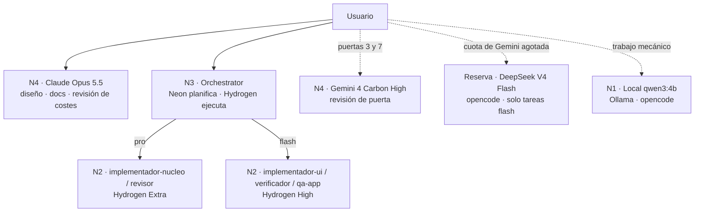

# Agentes y modelos: jerarquía, peso y razonamiento

Con **Claude Pro**, **Google AI Pro** y **DeepSeek por API** como reserva, la combinación con mejor relación calidad/cuota es:

- **Claude (Opus 5.5 en Claude Code)** diseña, documenta y revisa lo delicado. Es la cuota más escasa: no programa.
- **Antigravity en modo Orchestrator** programa: Gemini 4 Neon planifica y Gemini 4 Hydrogen ejecuta. Seis subagentes con nivel `pro` o `flash`.
- **Gemini 4 Carbon (High)** solo en dos revisiones de puerta (fases 3 y 7).
- **Modelo local** (Ollama) para trabajo mecánico que no necesita calidad.
- **DeepSeek V4 Flash** (opencode) como reserva cuando se agota la cuota de Gemini, y solo para tareas de nivel `flash`.

Lo que ya se midió en AZ-900 con este mismo Antigravity (26/11/2026) se da por bueno: `flash` = Hydrogen High, `pro` = Hydrogen Extra; herramientas reales `read_file`, `write_file`, `edit_file`, `run_command`, `manage_task`, `send_message`, `invoke_subagent`, `search_web`. La fase 0 lo vuelve a comprobar.

## 1. La jerarquía



| Nivel | Razonamiento | Modelo | Coste relativo | Hace | No hace nunca |
| --- | --- | --- | --- | --- | --- |
| **N4 Arquitecto** | Máximo | Claude Opus 5.5 · Gemini 4 Carbon High | Muy alto (cuota escasa) | Spec, plan, contratos, respuestas a `handoff/`, revisión de puertas 3 y 7 | Escribir código de `app/` |
| **N3 Planificador** | Alto | Gemini 4 Neon (planner del Orchestrator) | Alto | Leer fases, repartir tareas, fusionar ramas, informes | Implementar tareas él mismo |
| **N2 Implementador** | Extra (`pro`) o High (`flash`) | Gemini 4 Hydrogen | Medio | Código con TDD, verificación, QA | Cambiar `docs/` |
| **N1 Mecánico** | Bajo | `qwen3:4b` local (Ollama) | 0 € | Resumir salidas largas, borradores de commit, variantes de datos de prueba | Decidir diseño, tocar el núcleo |
| **Reserva** | Medio | DeepSeek V4 Flash (opencode) | Céntimos | Tareas `flash` cuando Gemini no tiene cuota | Núcleo, costes, revisiones |

## 2. Peso y razonamiento de cada tarea

**Peso** = tamaño y número de archivos (S < 200 líneas, M 200–600, L > 600). **Razonamiento** = cuánto cuesta detectar un error: alto si un fallo pasa las pruebas débiles y se paga después (contar mal, cobrar mal); medio si las pruebas o una captura lo detectan enseguida.

| Tarea | Peso | Razonamiento | Agente | Nivel | Revisión | ¿Reserva DeepSeek? |
| --- | --- | --- | --- | --- | --- | --- |
| T1 Proyecto Tauri | M | Medio | `implementador-nucleo` | `pro` | verificador | No |
| T2 Modelo y BD | M | Alto | `implementador-nucleo` | `pro` | revisor | No |
| T3 Colector Claude Code | M | Alto | `implementador-nucleo` | `pro` | revisor | No |
| T4 Colector Antigravity | S | Medio | `implementador-nucleo` | `pro` | revisor | No |
| T5 Ingestión | L | Alto | `implementador-nucleo` | `pro` | revisor | No |
| T6 Precios y coste | M | **Máximo** | `implementador-nucleo` | `pro` | revisor + **Carbon** + **Claude** | No |
| T7 Consultas | L | Alto | `implementador-nucleo` | `pro` | revisor + **Carbon** | No |
| T8 Planes y ventanas | M | Alto | `implementador-nucleo` | `pro` | revisor + **Carbon** + **Claude** | No |
| T9 Alertas | S | Medio | `implementador-nucleo` | `pro` | revisor | No |
| T10 Capa de escritorio | L | Alto | `implementador-nucleo` | `pro` | revisor | No |
| T11 Interfaz base y Panel | L | Medio | `implementador-ui` | `flash` | qa-app | **Sí** |
| T12 Costes y Sesiones | M | Medio | `implementador-ui` | `flash` | qa-app | **Sí** |
| T13 Planes, Fuentes, Ajustes | M | Medio | `implementador-ui` | `flash` | qa-app | **Sí** |
| T14 opencode y DeepSeek | M | Alto | `implementador-nucleo` | `pro` | revisor | No |
| T15 Exportar e importar | S | Medio | `implementador-nucleo` | `pro` | revisor | No |
| T16 Entrega | M | Medio | `implementador-nucleo` + usuario | `pro` | **Carbon** + usuario | No |

Reglas para asignar, en orden:

1. **`pro`** si el error es silencioso y caro: contar tokens, calcular dinero, límites, seguridad, concurrencia.
2. **`flash`** si las pruebas o una captura lo detectan enseguida: interfaz desde un mockup, ejecutar pruebas, recorrer pantallas.
3. **Escalar, nunca empezar por arriba** (cascada al estilo *FrugalGPT*): una tarea `flash` que falla dos veces se repite en `pro`; una `pro` que falla dos veces se para y se escribe en `handoff/preguntas.md`.
4. **Lo más caro, donde un error cuesta dinero**: Carbon y Claude revisan precios, coste y planes (fase 3), porque un error ahí hace que la app mienta justo sobre lo que mide.

## 3. Los agentes de Antigravity

| Agente (archivo) | Nivel | Ejecución de comandos | Hace | No hace |
| --- | --- | --- | --- | --- |
| Conversación principal | Orchestrator (Neon + Hydrogen) | — | Lee la fase, invoca subagentes, fusiona, escribe informes | Implementar |
| `implementador-nucleo` | `pro` | `auto` (necesita `cargo`, red para crates) | T1–T10, T14–T16 con TDD | Tocar `app/src/` (salvo T1) |
| `implementador-ui` | `flash` | `auto` (necesita `npm`) | T11–T13 desde los mockups | Tocar `app/src-tauri/` |
| `verificador` | `flash` | `auto` | `cargo test`, `cargo clippy`, `npm test`, `tsc`, puertas | Cambiar archivos |
| `revisor` | `pro` | `sandbox` | Revisa el diff de la fase contra spec, plan y contratos | Cambiar archivos |
| `qa-app` | `flash` | `auto` | Abre `npm run dev` (interfaz con datos simulados) en el navegador integrado, compara con los mockups, recorre los casos de uso visuales | Cambiar `app/` |

La ventana real de Tauri (bandeja, notificaciones, lectura de logs reales) la prueba **el usuario** en las puertas 4 y 7: Antigravity no puede controlar una ventana nativa.

## 4. Modelos locales: qué cabe en tu PC

Tu equipo: RTX 2050 con **4 GB de VRAM** y **16 GB de RAM**. Un modelo es útil si cabe entero en la VRAM (o casi) y deja ~1 GB para el contexto.

| Modelo propuesto | Tamaño real (Q4) | ¿Cabe? | Veredicto |
| --- | --- | --- | --- |
| Qwen3.8 27B | ~17 GB | No (ni en VRAM ni cómodo en RAM) | Descartado en local. Muy bueno para código, pero solo vía API |
| Qwen3-Coder 30B-A3B | ~19 GB | No | Descartado en local; vía API es de los más baratos |
| DeepSeek-R1-Distill 32B | ~20 GB | No | Descartado: además lo supera DeepSeek V4 por API |
| Llama 4 Scout | 55–67 GB | No | No existen versiones de 7B ni 27B |
| Gemma 4 «9B» | — | — | No existe; Gemma 4 viene en E2B, E4B, 26B y 31B |
| Gemma 4 E4B | ~4 GB | Justo (desborda a RAM) | Candidato secundario |
| **Qwen3 4B** | ~2,5 GB | **Sí** | **Elegido para N1** (razonamiento activable) |
| Qwen3.5 2B / Qwen2.5-Coder 3B | ~2–2,7 GB | Sí | Alternativas si Qwen3 4B va lento |

**Calibración (fase 0):** con `ollama pull` de los 3 candidatos, se mide cada uno en 3 trabajos N1 (resumir una salida de `cargo build` con 40 errores; proponer un mensaje de commit para un diff; generar 5 variantes de una línea de fixture con números distintos). Gana el que acierte más en menos de 20 s. Las etiquetas exactas (`qwen3:4b`, `gemma4:e4b`…) se comprueban con `ollama pull`: las listas de internet de 2026 tienen nombres erróneos.

**Para qué sirve de verdad el N1:** ahorrar cuota de Gemini y de Claude en trabajo sin juicio. No escribe Rust de la app: con 4 GB de VRAM ningún modelo local programa Rust con la calidad que exige este proyecto.

Uso típico, desde PowerShell en la raíz del proyecto:

```powershell
cargo build 2>&1 | ollama run qwen3:4b "Resume estos errores de compilación en una lista: archivo, línea, causa. Sin proponer soluciones."
git diff --staged | ollama run qwen3:4b "Propón un mensaje de commit en español, estilo 'feat: …', de una línea."
```

## 5. La reserva: DeepSeek con opencode

- **Cuándo:** la cuota de 5 h de Google AI Pro se agota a mitad de una fase de interfaz (T11–T13) o hace falta verificar.
- **Cómo:** en `E:\Proyectos\Gestior de Tokens\Alpha`, `opencode` con el modelo de DeepSeek configurado en la fase 0. opencode lee `AGENTS.md` igual que Antigravity, así que se le da el mismo prompt de la fase con la skill escrita a mano: «Lee `.agents/skills/ejecutar-tarea-tdd/SKILL.md` y ejecuta T12».
- **Nunca** para `implementador-nucleo`, `revisor` ni Carbon: lo que cuenta tokens o dinero lo hace siempre la misma familia de modelos, para que los errores sean coherentes y la revisión los encuentre.
- **Presupuesto:** 10 $ al mes (plan `deepseek`). El propio Gestor de Tokens lo vigila en cuanto exista la fase 6; hasta entonces, el panel de DeepSeek.
- **Modelo exacto:** el id (`deepseek-v4-flash` u otro) se confirma en la fase 0 con `GET https://api.deepseek.com/models`.

## 6. Reglas para ahorrar cuota

- **Una tarea por invocación** de subagente; el prompt lleva el número de tarea y la skill carga el resto. Contexto mínimo: cada agente lee solo su tarea y los contratos que cita (*Lost in the Middle*, Stanford 2023).
- **Paralelo solo donde el plan lo permite:** T3 ∥ T4, T7 ∥ T8, T12 ∥ T13, y las fases 4 y 5 entre sí.
- **Carbon dos veces en todo el proyecto.** Si encuentra problemas, los corrige `implementador-nucleo`, no Carbon.
- **Claude solo con Opus para documentar y revisar**, y con `/usage` a mano: este proyecto es la prueba de que hace falta un gestor de tokens.
- **Mirar la cuota antes de cada fase** («View Usage» en Antigravity; `/usage` en Claude Code). Las fases 2, 3 y 5 son las que más gastan.
- **Si se acaba la cuota de 5 h de Gemini:**
  - **Preferida:** esperar a que se renueve; las tareas son atómicas y se retoman por número.
  - **Reserva:** DeepSeek con opencode, solo tareas `flash` (§5).

## 7. Fuentes

- Investigación de modelos: [`00-investigacion.md`](00-investigacion.md); tamaños de Ollama: [morphllm](https://www.morphllm.com/best-ollama-models), [localaimaster 4 GB](https://localaimaster.com/vram/best-ollama-models-4gb-vram), [Gemma 4 vs Llama 4](https://codersera.com/blog/gemma-4-vs-llama-4-local-deployment-2026), [Qwen3-Coder local](https://llmconfigurator.com/en/guides/coding-agents/run-qwen3-coder-locally).
- Precios de reserva: [DeepSeek](https://api-docs.deepseek.com/quick_start/pricing), [coste por tarea](https://ssojet.com/blog/cheapest-ai-coding-models.md).
- Cascadas y enrutado de modelos: Chen, Zaharia y Zou (Stanford, 2023), *FrugalGPT*; Ong et al. (UC Berkeley/LMSYS, 2024), *RouteLLM*.
- Contexto largo: Liu et al. (Stanford, 2023), *Lost in the Middle*.
- Antigravity: modelos, subagentes, skills, reglas y cuotas (ver `E:\Proyectos\Azure\AZ-900\docs\02-agentes-y-modelos.md` §5).
