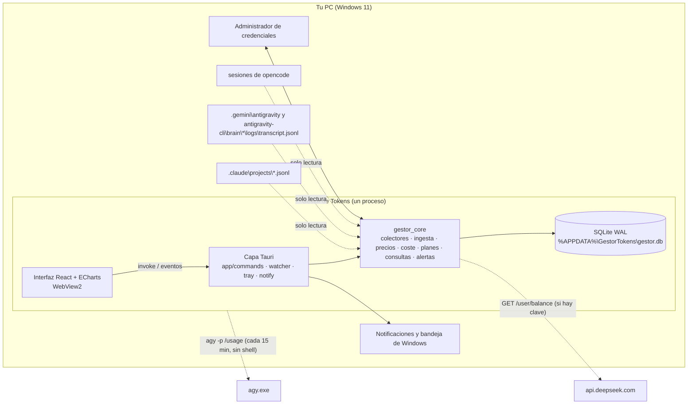

# Arquitectura

App de escritorio de un solo usuario. Un proceso Tauri contiene el núcleo Rust y una ventana WebView2 con la interfaz React. Lee los logs de las herramientas de IA en modo solo lectura y guarda todo en un archivo SQLite. La única conexión de red es la consulta del saldo de DeepSeek, si el usuario guarda una clave.

Vista de contexto y de contenedores al estilo C4 (Simon Brown).

## 1. Componentes



| Módulo | Archivo | Responsabilidad | Depende de |
| --- | --- | --- | --- |
| Modelo | `core/model.rs` | `UsageEvent`, `Tool`, `Provider`, `provider_for` | — |
| Tiempo | `core/time.rs` | Día local, horas entre instantes | `chrono` |
| BD | `core/db/*` | Esquema, apertura, migración | `rusqlite` |
| Colectores | `core/collectors/*` | Leer un log desde un offset y devolver eventos | modelo, `serde_json` |
| Ingesta | `core/ingest.rs` | Offsets, idempotencia, agregados, errores | colectores, BD, coste |
| Precios y coste | `core/pricing.rs`, `core/cost.rs` | Tabla de precios, coste por evento, recálculo | BD |
| Planes | `core/plans.rs` | Ventanas, calibración, ritmo | BD |
| Consultas | `core/query.rs` | Datos de Panel, Costes y Sesiones | BD |
| Alertas | `core/alerts.rs` | Reglas y registro de disparos | planes, consultas |
| DeepSeek | `core/deepseek.rs` | Saldo | `reqwest` |
| Secretos | `core/secrets.rs` | Clave en el Administrador de credenciales | `keyring` |
| Exportar | `core/export.rs` | CSV, JSON, importación | BD |
| Capa Tauri | `app/*` | Comandos, vigilancia, bandeja, notificaciones | `core`, Tauri |
| Interfaz | `src/*` | 6 pantallas + bandeja | comandos |

**Regla de dependencias:** `core` no importa nada de `tauri` (se comprueba con `cargo tree -p gestor_core` en la puerta 1). Para que eso sea posible, `gestor_core` es **un crate aparte del workspace de Cargo**: `app/src-tauri/src/core/Cargo.toml` con `[lib] path = "mod.rs"`, y `app/src-tauri/Cargo.toml` declara `[workspace] members = [".", "src/core"]`. La capa Tauri lo reexporta con `pub use gestor_core as core;` (decisión de T1, aceptada en la fase 1). Las dependencias de `core` van en su propio `Cargo.toml`. Al leer la salida de `cargo tree`, la ruta contiene `src-tauri`, pero eso no es una dependencia. **Fechas:** siempre con `core::time::fmt_utc` (ISO 8601 con `Z`), nunca con `to_rfc3339()`. Los comandos solo validan, llaman a `core` y traducen errores. La interfaz solo habla con Rust por `src/api.ts`.

## 2. Dependencias permitidas

No se añade ninguna otra sin preguntarlo antes en `handoff/preguntas.md`.

**Rust (`app/src-tauri/Cargo.toml`)**

| Crate | Para qué |
| --- | --- |
| `tauri` 2 (features `tray-icon`, `image-png`), `tauri-build` 2 | Ventana, comandos, bandeja |
| `tauri-plugin-notification`, `tauri-plugin-autostart`, `tauri-plugin-single-instance`, `tauri-plugin-dialog` (2.x) | Notificaciones, autoarranque, una sola instancia, guardar/abrir archivo |
| `rusqlite` (feature `bundled`) | SQLite sin dependencias del sistema |
| `serde`, `serde_json` | JSON |
| `chrono` (feature `serde`) | Fechas |
| `notify` 6, `notify-debouncer-mini` | Vigilar carpetas |
| `tokio` (features `rt-multi-thread`, `time`, `sync`, `macros`) | Tareas de fondo |
| `reqwest` (features `json`, `rustls-tls`, sin `default-features`) | Saldo de DeepSeek |
| `keyring` 3 (feature `windows-native`) | Administrador de credenciales |
| `globset` | Patrones de modelo en precios |
| `thiserror`, `tracing`, `tracing-subscriber` | Errores y logs propios |
| `dirs` | `%USERPROFILE%` y `%APPDATA%` |
| Desarrollo: `tempfile`, `pretty_assertions` | Pruebas |

**Node (`app/package.json`)**

| Paquete | Tipo | Para qué |
| --- | --- | --- |
| `@tauri-apps/api` 2, `@tauri-apps/plugin-notification`, `@tauri-apps/plugin-dialog` | producción | Puente con Rust |
| `react`, `react-dom` 19, `react-router` 7 | producción | Interfaz |
| `echarts` 5 | producción | Gráficos |
| `@tauri-apps/cli` 2, `typescript`, `vite`, `@vitejs/plugin-react` | desarrollo | Compilar |
| `vitest`, `jsdom`, `@testing-library/react`, `@testing-library/user-event`, `@testing-library/jest-dom`, `@types/react`, `@types/react-dom` | desarrollo | Pruebas |

## 3. Esquema SQLite exacto (`core/db/schema.sql`)

Los PRAGMA no van en `schema.sql`. `open_db` ejecuta `journal_mode = WAL`, `foreign_keys = ON` y `busy_timeout = 5000` antes de la transacción. Dentro de una sola transacción aplica el esquema, siembra los planes y pone `user_version = 1`, para que un fallo a medias no deje la base inservible (corrección de la fase 1).

```sql
CREATE TABLE usage_event (
  dedup_key        TEXT PRIMARY KEY,
  tool             TEXT NOT NULL CHECK (tool IN ('claude-code','antigravity','opencode')),
  provider         TEXT NOT NULL CHECK (provider IN ('anthropic','google','deepseek','other')),
  plan_id          TEXT NOT NULL REFERENCES plan(id),
  model            TEXT NOT NULL,
  ts_utc           TEXT NOT NULL,              -- ISO 8601 con Z
  session_id       TEXT NOT NULL,
  project          TEXT,
  input            INTEGER NOT NULL DEFAULT 0,
  cache_write      INTEGER NOT NULL DEFAULT 0,
  cache_read       INTEGER NOT NULL DEFAULT 0,
  output           INTEGER NOT NULL DEFAULT 0,
  reasoning        INTEGER NOT NULL DEFAULT 0,
  cost_usd         REAL,                       -- NULL si no hay precio
  cost_kind        TEXT NOT NULL DEFAULT 'unknown' CHECK (cost_kind IN ('real','api_equivalent','unknown')),
  price_id         INTEGER REFERENCES price(id),
  cost_computed_at TEXT,
  source_file_id   INTEGER REFERENCES source_file(id)
);
CREATE INDEX ix_event_ts      ON usage_event(ts_utc);
CREATE INDEX ix_event_session ON usage_event(session_id, ts_utc);
CREATE INDEX ix_event_model   ON usage_event(model, ts_utc);
CREATE INDEX ix_event_plan    ON usage_event(plan_id, ts_utc);

CREATE TABLE hourly_agg (
  hour_utc    TEXT NOT NULL,                   -- 'YYYY-MM-DDTHH:00:00Z'
  tool        TEXT NOT NULL,
  provider    TEXT NOT NULL,
  plan_id     TEXT NOT NULL,
  model       TEXT NOT NULL,
  project     TEXT NOT NULL DEFAULT '',
  turns       INTEGER NOT NULL DEFAULT 0,
  input       INTEGER NOT NULL DEFAULT 0,
  cache_write INTEGER NOT NULL DEFAULT 0,
  cache_read  INTEGER NOT NULL DEFAULT 0,
  output      INTEGER NOT NULL DEFAULT 0,
  cost_real   REAL NOT NULL DEFAULT 0,
  cost_equiv  REAL NOT NULL DEFAULT 0,
  unpriced    INTEGER NOT NULL DEFAULT 0,
  PRIMARY KEY (hour_utc, tool, provider, plan_id, model, project)
);

CREATE TABLE source_file (
  id          INTEGER PRIMARY KEY,
  collector   TEXT NOT NULL,
  path        TEXT NOT NULL UNIQUE,
  size        INTEGER NOT NULL,
  mtime       TEXT NOT NULL,
  read_offset INTEGER NOT NULL DEFAULT 0,
  last_read   TEXT NOT NULL
);

CREATE TABLE ingest_error (
  id        INTEGER PRIMARY KEY,
  source_file_id INTEGER NOT NULL REFERENCES source_file(id) ON DELETE CASCADE,
  line      INTEGER NOT NULL,
  reason    TEXT NOT NULL,
  at        TEXT NOT NULL,
  UNIQUE (source_file_id, line)
);

CREATE TABLE price (
  id            INTEGER PRIMARY KEY,
  provider      TEXT NOT NULL,
  model_pattern TEXT NOT NULL,
  valid_from    TEXT NOT NULL,                 -- 'YYYY-MM-DD'
  valid_to      TEXT,                          -- exclusivo; NULL = vigente
  input         REAL NOT NULL,                 -- $ por millón
  output        REAL NOT NULL,
  cache_write   REAL NOT NULL,
  cache_read    REAL NOT NULL,
  source_url    TEXT NOT NULL,
  approximate   INTEGER NOT NULL DEFAULT 0,
  user_edited   INTEGER NOT NULL DEFAULT 0,
  UNIQUE (model_pattern, valid_from)
);

CREATE TABLE cost_recalc_log (
  id         INTEGER PRIMARY KEY,
  at         TEXT NOT NULL,
  price_id   INTEGER NOT NULL REFERENCES price(id),
  events     INTEGER NOT NULL,
  old_total  REAL NOT NULL,
  new_total  REAL NOT NULL
);

CREATE TABLE plan (
  id              TEXT PRIMARY KEY,            -- 'claude-pro','google-ai-pro','google-ai-pro-claude','deepseek'
  name            TEXT NOT NULL,
  provider        TEXT NOT NULL,
  kind            TEXT NOT NULL CHECK (kind IN ('subscription','payg')),
  monthly_fee_usd REAL NOT NULL DEFAULT 0,
  budget_usd      REAL,
  windows         TEXT NOT NULL DEFAULT '[]'   -- JSON: [{"name":"5h","hours":5},{"name":"weekly","hours":168}]
);

CREATE TABLE plan_calibration (
  id       INTEGER PRIMARY KEY,
  plan_id  TEXT NOT NULL REFERENCES plan(id),
  win_name TEXT NOT NULL CHECK (win_name IN ('5h','weekly')),
  at       TEXT NOT NULL,
  percent  REAL NOT NULL CHECK (percent > 0 AND percent <= 100),
  used     REAL NOT NULL,
  limit_est REAL NOT NULL,
  source   TEXT NOT NULL DEFAULT 'user' CHECK (source IN ('user','agy')),
  resets_at TEXT                              -- solo source = 'agy': reinicio oficial de la ventana
);

CREATE TABLE alert_fired (
  rule   TEXT NOT NULL,
  key    TEXT NOT NULL,
  at     TEXT NOT NULL,
  PRIMARY KEY (rule, key)
);

CREATE TABLE setting (
  key   TEXT PRIMARY KEY,
  value TEXT NOT NULL
);
```

`alert_rule` de la spec se simplifica: las reglas son fijas en código (`docs/06-colectores-y-costes.md` §5) y sus umbrales se guardan en `setting` (`alert.window5h.levels` = `[80,95]`, etc.). `daily_agg` no hace falta: los días salen de `hourly_agg`.

## 4. Hilos y concurrencia

- Un `Mutex<Connection>` en `AppState`. Las escrituras (ingesta, precios, calibración) y las lecturas comparten conexión; con WAL y consultas sobre `hourly_agg` basta para un solo usuario.
- La vigilancia y el escaneo periódico corren en tareas de `tokio`; la ingesta se hace con `spawn_blocking`.
- La interfaz nunca espera a la ingesta: recibe `usage-updated` y vuelve a pedir datos.

## 5. Seguridad

- `capabilities/default.json`: solo `core:default`, `notification:default`, `autostart:default`, `dialog:allow-save`, `dialog:allow-open`. Sin `fs`, `shell` ni `http` para la interfaz.
- CSP en `tauri.conf.json`: `default-src 'self'; style-src 'self' 'unsafe-inline'; img-src 'self' data:; connect-src ipc: http://ipc.localhost`.
- La clave de DeepSeek nunca cruza a la interfaz: `set_deepseek_key` la recibe y la guarda; ningún comando la devuelve.
- Los logs propios (`tracing`) van a `%APPDATA%\GestorTokens\logs\` y nunca incluyen claves ni contenido de los logs leídos.

## 6. Decisiones (ADR resumidas)

| # | Decisión | Motivo | Alternativa descartada |
| --- | --- | --- | --- |
| ADR-1 | Leer logs locales | Ve las suscripciones; no toca las herramientas | Proxy HTTP, OTLP |
| ADR-2 | Coste guardado por evento | Consultas rápidas y trazabilidad del precio usado | Calcular al consultar |
| ADR-3 | `hourly_agg` mantenido en la ingesta | Panel de 90 días < 300 ms | Vistas calculadas al vuelo |
| ADR-4 | `core` sin Tauri | Pruebas sin ventana, reutilizable en una CLI | Todo en comandos |
| ADR-6 | Google AI Pro se calibra solo con `agy -p "/usage" --output-format json` (decisión del usuario, 27/11/2026) | Da el % oficial y el reinicio de cada ventana, gasta 0 tokens y tarda unos 3 s | Calibrar Google a mano |
| ADR-5 | Límites calibrados por el usuario | Los proveedores no publican límites en tokens | Valores fijos inventados |
| ADR-6 | NSIS por usuario | Sin permisos de administrador | MSI |
