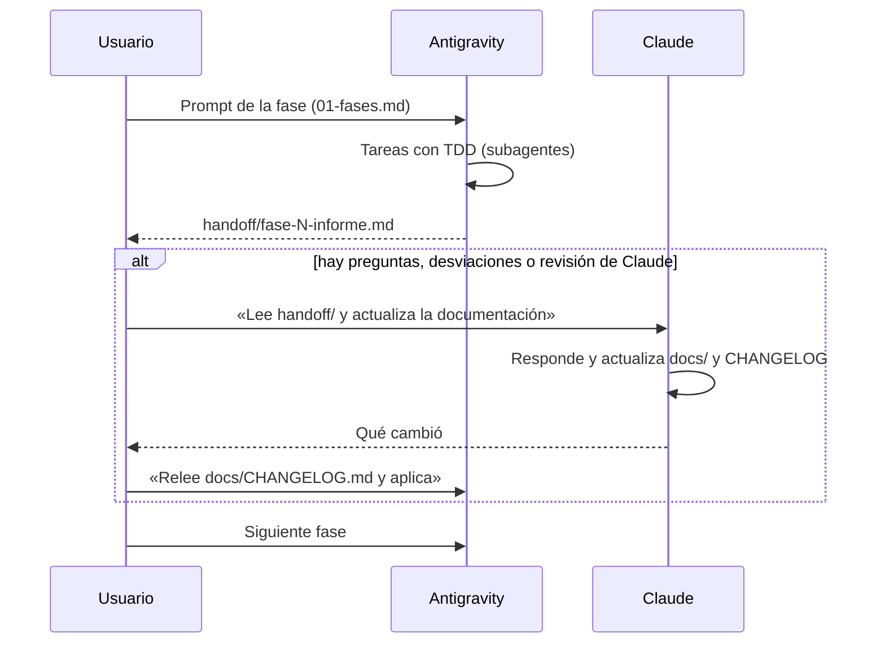

# Protocolo de trabajo Claude ↔ Antigravity

## 1. Papeles

| Quién | Hace | Escribe en |
| --- | --- | --- |
| **Usuario** | Decide, instala el entorno, lanza cada fase, prueba la app real, aprueba las puertas | — |
| **Claude** (Claude Code, Opus 5.5) | Toda la documentación: diseño, plan, fases, contratos, mockups, reglas, agentes y skills. Responde preguntas. Revisa costes y planes (fase 3) | `docs/`, `AGENTS.md`, `.agents/` |
| **Antigravity** (Orchestrator y subagentes) | Todo el código y las pruebas, siguiendo la documentación | `app/`, `handoff/` |
| **opencode** (DeepSeek V4.1 Flash: gratis y, al agotarse, de pago con tope de 5 $) | T13, T15 y verificación, con las mismas reglas que Antigravity | `app/` (tareas `flash`), `handoff/` |

## 2. Ciclo de una fase



## 3. Preguntas de Antigravity

`handoff/preguntas.md`: una entrada por pregunta, las más nuevas arriba.

```markdown
## P-007 · 2026-12-03 · Fase 3 · T8 · bloqueante: sí

**Documento:** docs/06-colectores-y-costes.md §2
**Duda:** el plan dice X y el contrato dice Y.
**Lo que haré mientras tanto:** sigo con T7, que no depende de esto.
**Propuesta:** …
```

Claude responde en `docs/respuestas.md` con el mismo número (`## R-007`). Si la respuesta cambia la documentación, actualiza el documento y lo anota en `docs/CHANGELOG.md`.

## 4. Cambios en la documentación

- Solo Claude edita `docs/`, `AGENTS.md` y `.agents/`.
- Cada cambio va en `docs/CHANGELOG.md`: fecha, documento, qué cambió y a qué tareas o fases afecta.
- Un cambio que afecta a una tarea ya terminada se convierte en una tarea nueva `T<n>.1` en el plan, con sus propias pruebas. Nunca se reescribe en silencio una tarea hecha.

## 5. Canal directo: Claude → Antigravity con `agy -p`

Igual que en AZ-900: Claude puede consultar a Antigravity con el CLI `agy` en modo no interactivo.

- **Consultas (permitido sin preguntar):** `--mode plan` (solo lectura), `--print-timeout 360s`, `--output-format json`.
- **Lanzar una fase o algo que escriba código:** solo si el usuario lo pide en ese momento, sin `--mode plan`, nunca con `--dangerously-skip-permissions`, con el prompt literal de `01-fases.md`.
- Claude anota cada uso relevante en `respuestas.md` con el id de conversación.

```bash
cd "E:/Proyectos/Gestior de Tokens/Alpha"
agy -p "<prompt>" --mode plan --print-timeout 360s --output-format json < /dev/null
```

## 6. Privacidad entre agentes

Ningún agente copia en `handoff/`, en commits ni en mensajes el **contenido** de los logs de Claude Code, Antigravity u opencode (prompts, respuestas, razonamientos). Solo estructura y números. Lo mismo para la clave de DeepSeek.

## 7. Cómo pedirle algo a Claude

En Claude Code, desde `E:\Proyectos\Gestior de Tokens\Alpha`:

- «Lee `handoff/preguntas.md` y responde las pendientes.»
- «Lee `handoff/fase-N-informe.md` y dime si la puerta está bien cerrada.»
- «Revisa la fase 3 (costes y planes).»
